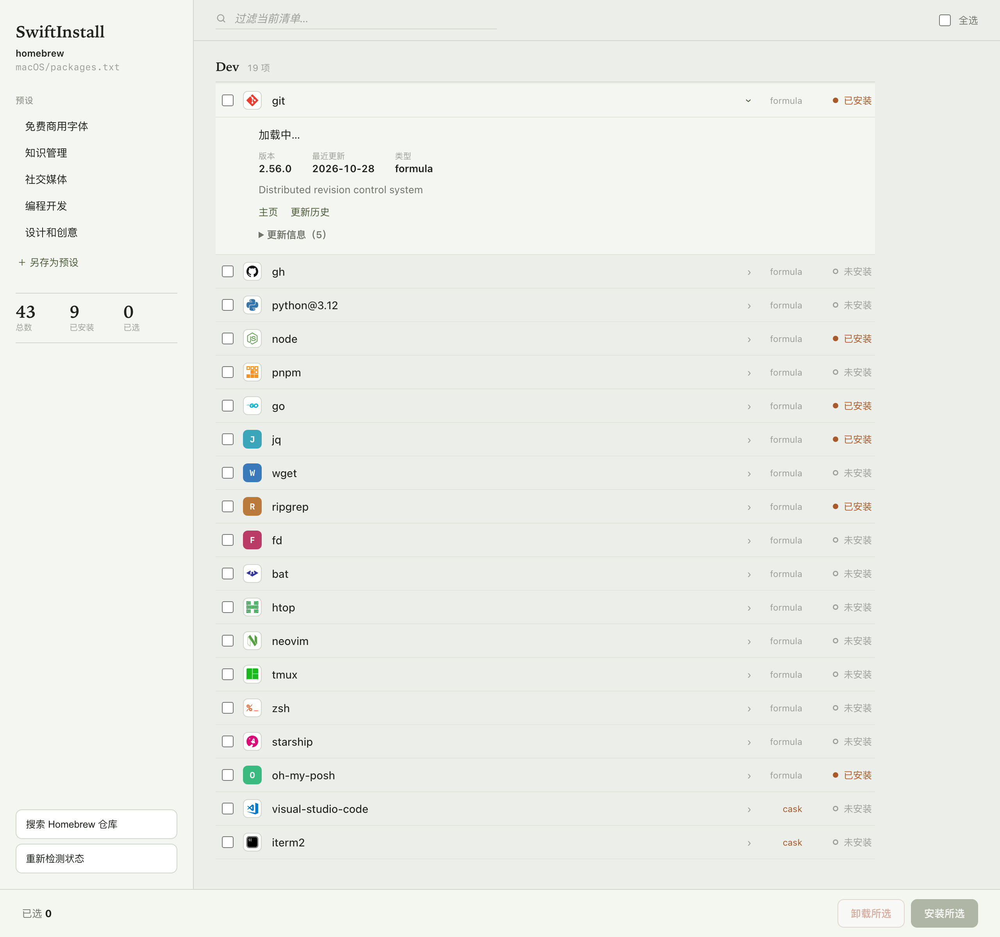
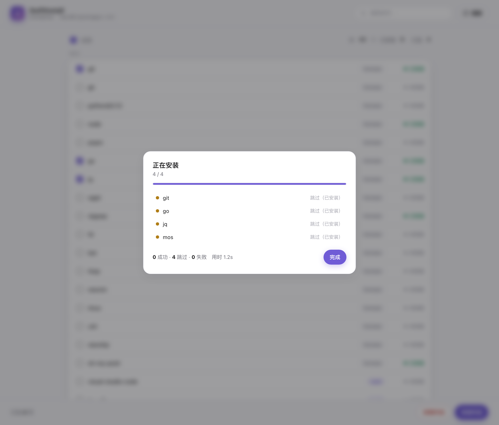

# SwiftInstall

<p align="center">
  <b>macOS 与 Windows 的批量软件安装工具</b><br>
  <sub>一条命令装好一整台新机器 — macOS 用 Homebrew，Windows 用 winget</sub>
</p>

<p align="center">
  
  
  
  
</p>

---

## 目录

- [项目概述](#项目概述)
- [核心特性](#核心特性)
- [快速开始](#快速开始)
  - [环境要求](#环境要求)
  - [一键安装](#一键安装)
  - [手动安装](#手动安装)
- [使用指南](#使用指南)
  - [命令总览](#命令总览)
  - [gui — 图形界面](#gui--图形界面)
  - [tui — 交互式终端界面](#tui--交互式终端界面)
  - [install — 批量安装](#install--批量安装)
  - [uninstall — 批量卸载](#uninstall--批量卸载)
  - [list — 查看软件清单](#list--查看软件清单)
  - [status — 检查安装状态](#status--检查安装状态)
  - [version — 版本信息](#version--版本信息)
- [Homebrew 后端与 formula / cask](#homebrew-后端与-formula--cask)
- [Manifest 文件格式](#manifest-文件格式)
- [项目结构](#项目结构)
- [贡献指南](#贡献指南)
- [许可证](#许可证)

---

## 项目概述

**SwiftInstall** 是一个开源的批量软件安装工具。核心是一个现代化的 Go CLI —— `sis`，按清单文件把新系统所需的软件一次装好。

- **macOS** 是一等公民：基于 [Homebrew](https://brew.sh/)，同时支持 **formula** 与 **cask**（GUI 应用）。
- **Windows** 继续支持：基于原生 `winget`。
- 后端按操作系统**自动选择**，同一份清单在两端都能用（包 ID 各自适配）。

设计上追求**简单、克制、可预期**：一个二进制、一份清单、几条命令，没有配置文件，没有隐藏状态。

---

## 核心特性

| 特性 | 说明 |
|------|------|
| **macOS 完整支持** | Homebrew 后端，formula 与 cask 双通道 |
| **Windows 支持** | 原生 `winget` 后端，覆盖安装 / 卸载 / 查询 |
| **后端自动选择** | 按操作系统自动选用 Homebrew 或 winget，无需手动切换 |
| **图形界面 (GUI)** | `sis gui` 在浏览器窗口内可视化浏览、勾选并一键安装/卸载，实时状态与进度 |
| **交互式 TUI** | `sis tui` 在终端内提供可视化的清单浏览与安装界面 |
| **批量安装 / 卸载** | 遍历清单逐条执行，单个失败不中断整批 |
| **多格式输出** | `table` / `json` / `silent`，适配脚本与人读 |
| **去重与跳过** | 自动去重重复包，可跳过已安装软件 |
| **重试机制** | 失败自动重试，可配置次数与间隔 |
| **镜像加速** | 安装脚本与下载支持 `SIS_MIRROR` 镜像 |
| **零配置** | 纯 flag 驱动，无配置文件、无持久化 |

---

## 快速开始

### 环境要求

#### macOS

- **操作系统**：macOS 11 (Big Sur) 或更高版本
- **依赖工具**：[Homebrew](https://brew.sh/)
- 未安装 Homebrew？执行 `sis install` 时会提示；也可先用官方脚本安装：

  ```sh
  /bin/bash -c "$(curl -fsSL https://raw.githubusercontent.com/Homebrew/install/HEAD/install.sh)"
  ```

#### Windows

- **操作系统**：Windows 10 1809+ / Windows 11
- **依赖工具**：[Windows Package Manager (winget)](https://learn.microsoft.com/zh-cn/windows/package-manager/winget/)（Windows 11 已预装）

---

### 一键安装

#### macOS

```sh
curl -fsSL https://raw.githubusercontent.com/cgartlab/SwiftInstall/main/install.sh | sh
```

中国大陆网络可加镜像加速（任选其一）：

```sh
# 通过 ghproxy 镜像
SIS_MIRROR=https://ghproxy.com sh -c "$(curl -fsSL https://raw.githubusercontent.com/cgartlab/SwiftInstall/main/install.sh)"

# 指定版本安装
SIS_VERSION=v0.2.3 sh -c "$(curl -fsSL https://raw.githubusercontent.com/cgartlab/SwiftInstall/main/install.sh)"
```

安装脚本会自动检测 Apple Silicon / Intel 架构，下载对应的 `sis-darwin-<arch>`，安装到 `/usr/local/bin`（不可写时回退到 `~/bin`），并验证 `sis version`。

#### Windows（PowerShell）

```powershell
irm https://raw.githubusercontent.com/cgartlab/SwiftInstall/main/install.ps1 | iex
```

中国大陆用户可设置镜像：

```powershell
$env:SIS_MIRROR='ghproxy.com'; irm https://raw.githubusercontent.com/cgartlab/SwiftInstall/main/install.ps1 | iex
```

---

### 手动安装

#### 方式一：下载预编译二进制

从 [Releases](https://github.com/cgartlab/SwiftInstall/releases) 下载对应平台的文件，放入 `PATH`：

| 平台 | 文件 |
|------|------|
| macOS (Apple Silicon) | `sis-darwin-arm64` |
| macOS (Intel) | `sis-darwin-amd64` |
| Windows | `sis-windows-amd64.exe` |
| Linux | `sis-linux-amd64`（暂无可用的包后端，仅供构建/试用） |

#### 方式二：从源码编译

```bash
git clone https://github.com/cgartlab/SwiftInstall.git
cd SwiftInstall
go build -ldflags "-X main.Version=$(cat VERSION)" -o sis ./cmd/sis/
```

#### 方式三：传统脚本（遗留方案）

项目仍保留原始脚本，适用于不想安装 CLI 的场景：

- **macOS**：`macOS/install_packages.sh`（读取同目录 `packages.txt`）
- **Windows**：`Windows/software_install.bat`（读取同目录 `software_list.txt`）

两个脚本同时接受 YAML 清单与纯 TXT 列表。

---

## 使用指南

### 命令总览

```text
sis gui        图形界面（浏览器窗口内浏览、勾选、一键安装/卸载）
sis tui        交互式终端界面（浏览清单、选择并安装）
sis search     在 Homebrew 仓库中搜索软件包
sis install    按清单批量安装软件
sis uninstall  按清单批量卸载软件
sis list       查看清单中的软件
sis status     检查各软件的安装状态
sis version    显示版本信息
```

全局选项：

```text
-f, --file string   清单文件路径（默认自动查找 sis.yaml / sis.yml / software_list.txt / packages.txt）
    --format string 输出格式：table, json, silent（默认 table）
    --no-color      禁用彩色输出
```

---

### gui — 图形界面

```bash
sis gui                       # 启动后自动在浏览器打开（仅本机 127.0.0.1）
sis gui --no-open             # 只启动服务，不自动开浏览器
sis gui -f macOS/packages.txt
sis gui --lan --port 8787     # 局域网预览：同网段设备可访问（仅限可信网络）
```

`--lan` 会把监听地址从 `127.0.0.1` 改为 `0.0.0.0`，并在启动时打印本机所有可访问的 URL（含局域网 IP），方便用手机或另一台电脑预览。此时安装/卸载会真实修改本机软件，**请只在可信网络中使用**。

启动一个**本地图形界面**：服务只监听本机回环地址（`127.0.0.1` 随机端口），不暴露到网络；在浏览器窗口中浏览按分类分组的软件清单，勾选后一键**安装/卸载**，安装状态与逐条进度实时刷新。每个软件显示对应的**品牌图标**（内嵌 SVG，缺失时用字母色块回退）。支持浅色/深色主题、搜索过滤、全选、已安装统计。

界面资源（HTML/CSS/JS）通过 `go:embed` 内嵌在二进制里，运行时不依赖外部文件；状态探测对 Homebrew 走一次性批量查询，数十个包也能秒级完成。技术栈为零依赖的原生 Web（无前端框架），按 `Ctrl+C` 关闭服务。





---

### tui — 交互式终端界面

```bash
sis tui
```

打开终端交互界面，直接浏览清单、勾选软件并执行安装，适合纯终端环境或 SSH 场景。基于 [Bubble Tea](https://github.com/charmbracelet/bubbletea) 构建。

---

### search — 搜索 Homebrew 仓库

```bash
sis search figma            # 搜索全部 formula / cask
sis search python --format json
```

在 Homebrew 全仓库（所有 tap 的 formula 与 cask）中搜索，结果标注频道与是否已安装。GUI 里点顶部「搜索 Homebrew」按钮可在浏览器中实时搜索，结果可一键加入清单再安装。

---

### install — 批量安装

```bash
# 使用默认清单（自动查找 sis.yaml / sis.yml / software_list.txt / packages.txt）
sis install

# 指定清单文件
sis install -f packages.txt

# 仅预览，不实际安装
sis install --dry-run

# 跳过已安装软件
sis install --skip-existing

# 使用代理
sis install --proxy http://127.0.0.1:10809

# 失败重试 3 次，间隔 5 秒
sis install --retry 3 --retry-delay 5
```

安装过程中逐条输出进度，最后给出汇总：

```text
Installing 4 packages from packages.txt

  [1/4] ✓ git (dev)
  [2/4] ✓ python@3.12 (dev)
  [3/4] ⚠ visual-studio-code (dev) — already installed
  [4/4] ✗ figma (design) — brew exited with code 1: No available formula or cask

  ────────────────────────────────────────
  Total: 4  |  2 succeeded  1 skipped  1 failed (38.1s)
```

> 安装失败不会中断整批，错误在最后汇总。标记 `optional: true` 的包失败时计入 `skipped`，不影响退出码。

---

### uninstall — 批量卸载

```bash
# 卸载清单中所有软件（必须加 --yes 确认）
sis uninstall -f packages.txt --yes

# 预览卸载（不实际执行）
sis uninstall -f packages.txt --yes --dry-run
```

---

### list — 查看软件清单

```bash
# 表格形式列出所有软件
sis list

# 指定清单
sis list -f packages.txt

# 按分类过滤
sis list --category dev

# JSON 输出
sis list --format json
```

示例输出：

```text
Packages from packages.txt

  dev
    git
    python@3.12

  design
    figma (optional)

  Total: 3 packages
```

---

### status — 检查安装状态

```bash
sis status
sis status -f packages.txt
```

示例输出：

```text
Checking status of 3 packages from packages.txt

  [1/3] ✓ git
  [2/3] ✓ python@3.12
  [3/3] ✗ figma

  2 installed, 1 missing
```

---

### version — 版本信息

```bash
sis version
```

示例输出：

```text
sis 0.2.3 (a1b2c3d, 2026-11-03)
```

---

## Homebrew 后端与 formula / cask

macOS 上 `sis` 使用 Homebrew。Homebrew 有两类包，通过清单里的 `kind` 字段区分：

| `kind` | 说明 | 例子 |
|--------|------|------|
| `formula` | 命令行工具、语言、库 | `git`、`python@3.12`、`oh-my-posh` |
| `cask` | GUI 应用与字体（`.app` / 字体） | `visual-studio-code`、`figma`、`font-hack-nerd-font` |
| 留空 | 自动探测：先按 formula，找不到再按 cask | 大多数情况可直接留空 |

> GUI 应用与字体请显式标注 `kind: cask`，避免与同名 formula 混淆或探测失败。

macOS 示例清单见 [`macOS/packages.txt`](macOS/packages.txt)，其中使用真实的 Homebrew 小写 token，并为 GUI 应用标注 `kind: cask`。可直接：

```bash
sis install -f macOS/packages.txt
```

---

## Manifest 文件格式

`sis` 支持 **YAML** 与 **TXT** 两种清单，默认按以下顺序自动查找：

1. `sis.yaml`
2. `sis.yml`
3. `software_list.txt`
4. `packages.txt`

格式以**内容**为准：含 `packages:` 或 `settings:` 键即按 YAML 解析，否则按 TXT 列表解析（所以 YAML 内容可以叫 `.txt`）。重复包 ID 会自动去重。

### YAML 格式

```yaml
settings:
  proxy: http://127.0.0.1:7890   # HTTPS 代理（可选）
  skip_existing: true            # 跳过已安装软件
  retry_count: 2                 # 失败重试次数
  retry_delay: 3                 # 重试间隔（秒）

packages:
  - id: git
    category: Dev
  - id: python@3.12
    category: Dev
  - id: visual-studio-code
    category: Dev
    kind: cask                   # macOS GUI 应用
  - id: figma
    category: Design
    kind: cask
    optional: true               # 失败不计入 failed
```

包级字段：

| 字段 | 类型 | 说明 |
|------|------|------|
| `id` | string | 包 ID / Homebrew token（必填） |
| `category` | string | 分类，仅用于 `sis list` 分组展示 |
| `kind` | string | `formula` 或 `cask`；留空自动探测（仅 Homebrew 后端使用） |
| `optional` | bool | `true` 时安装失败不计入 `failed`，不影响退出码 |

### TXT 格式

兼容传统脚本，每行一个包 ID，`#` 开头的行为注释（可作分类标题）：

```text
# dev
git
python@3.12

# design
figma
```

---

## 项目结构

```text
SwiftInstall/
├── cmd/sis/
│   └── main.go                     # CLI 入口（ldflags 注入版本）
├── internal/
│   ├── cli/                        # Cobra 命令
│   │   ├── root.go                 # 根命令与全局标志
│   │   ├── install.go              # install
│   │   ├── uninstall.go            # uninstall
│   │   ├── list.go                 # list
│   │   ├── status.go               # status
│   │   ├── gui.go                  # gui 图形界面（启动本地 Web 服务）
│   │   ├── tui.go                  # tui 交互式终端界面
│   │   ├── helpers.go              # 清单自动查找 + Renderer 选择
│   │   └── version.go              # version
│   ├── engine/                     # 批量安装/卸载编排（跳过、干跑、重试）
│   ├── manifest/                   # YAML/TXT 解析、去重、校验
│   ├── backend/                    # 后端接口 + 平台注册 + 实现
│   │   ├── backend.go              # Backend 接口、InstallOptions、Output
│   │   ├── registry.go             # ForCurrentOS：按 OS 自动选择后端
│   │   ├── homebrew.go             # Homebrew 后端（formula + cask）
│   │   └── winget.go               # winget 后端
│   ├── gui/                        # 本地 Web GUI：HTTP + SSE API + 内嵌前端
│   │   ├── gui.go                  # 服务、/api/state|status|run
│   │   └── assets/                 # index.html · styles.css · app.js（go:embed）
│   ├── tui/                        # 终端界面（bubbletea/lipgloss）
│   └── ui/                         # terminal / json / silent 渲染器
├── Windows/                        # 遗留 .bat 安装器 + 清单示例
├── macOS/                          # 遗留 .sh 安装器 + 清单示例
├── install.sh                      # macOS 一键安装脚本
├── install.ps1                     # Windows 一键安装脚本
├── VERSION                         # 当前产品版本
├── README.md
├── LICENSE
└── AGENTS.md
```

---

## 贡献指南

欢迎提交 Issue 与 Pull Request。

1. Fork 本仓库。
2. 新建分支：`git checkout -b feature/YourFeature`。
3. 提交改动：`git commit -m 'Add some feature'`。
4. 推送：`git push origin feature/YourFeature`。
5. 新建 Pull Request。

### 提交规范

- 保持代码简洁，遵循 Go 官方规范。
- 修改 CLI 命令或清单字段时，同步更新 `README.md` 与 `docs/CLI_USAGE.md`。
- 新增功能请补充必要的测试与文档。

---

## 许可证

本项目采用 [GNU General Public License v3.0](LICENSE)。

```text
SwiftInstall — Cross-platform batch software installer
Copyright (C) 2024 cgartlab

This program is free software: you can redistribute it and/or modify
it under the terms of the GNU General Public License as published by
the Free Software Foundation, either version 3 of the License, or
(at your option) any later version.

This program is distributed in the hope that it will be useful,
but WITHOUT ANY WARRANTY; without even the implied warranty of
MERCHANTABILITY or FITNESS FOR A PARTICULAR PURPOSE.  See the
GNU General Public License for more details.

You should have received a copy of the GNU General Public License
along with this program.  If not, see <https://www.gnu.org/licenses/>.
```

---

<p align="center">如果本项目对你有帮助，欢迎点亮 ⭐ Star 支持。</p>
